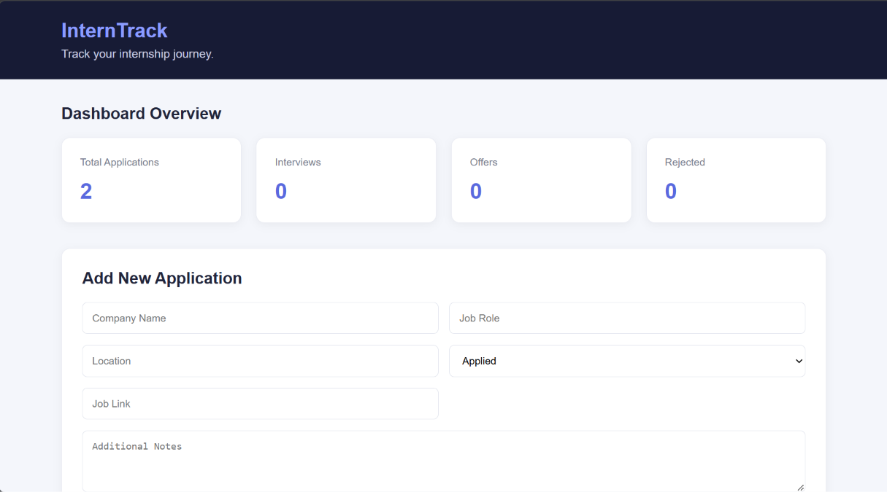

# InternTrack – Internship Application Tracker

InternTrack is a web-based application designed to help students organize and track their internship applications in one place.

The application provides a simple dashboard where users can add, view, search, update, and delete internship applications while monitoring their application progress through different statuses.

## Tech Stack

- **HTML5** – Structure of the application
- **CSS3** – Styling and responsive layout
- **JavaScript** – Frontend functionality and API integration
- **Node.js & Express.js** – Backend API
- **MongoDB Atlas** – Database
- **Mongoose** – Database modeling and interaction
- **REST API** – Communication between frontend and backend

## Features

- Add new internship applications.
- View all saved applications.
- Update existing application details.
- Delete applications.
- Search applications by company name.
- Filter applications by application status.
- Dashboard displaying application statistics:
  - Total applications
  - Interviews
  - Offers
  - Rejected applications
- Status indicators for different application stages.
- Loading and error handling during API requests.
- Responsive user interface for different screen sizes.

## How to Run the Project

### Prerequisites

Make sure you have the following installed:

- Node.js
- MongoDB Atlas account
- Git
- Visual Studio Code

### Backend Setup

1. Clone the backend repository:

   ```bash
   git clone https://github.com/pranavchauhan0102-ui/InternTrack-Backend-API.git
   ```

2. Open the backend project folder.

3. Install dependencies:

   ```bash
   npm install
   ```

4. Create a `.env` file and configure your MongoDB connection string and port.

5. Start the backend server:

   ```bash
   node server.js
   ```

### Frontend Setup

1. Clone this frontend repository:

   ```bash
   git clone https://github.com/pranavchauhan0102-ui/SWYNEX-Frontend-Integration.git
   ```

2. Open the frontend folder in Visual Studio Code.

3. Open `index.html` using the Live Server extension.

4. Make sure the backend server is running at `http://localhost:5000`.

5. The frontend will communicate with the backend through the REST API.

## API Endpoints

Base URL: `http://localhost:5000/api/applications`

| Method | Endpoint | Description |
|---|---|---|
| GET | `/` | Fetch all applications |
| GET | `/:id` | Fetch a specific application |
| POST | `/` | Create a new application |
| PUT | `/:id` | Update an application |
| DELETE | `/:id` | Delete an application |

### Query Parameters

The GET endpoint supports:

- `company` – Search applications by company name.
- `status` – Filter applications by status.
- `page` – Specify the page number.
- `limit` – Set the number of results per page.

## Project Structure

```text
SWYNEX-Frontend-Integration/
│
├── index.html       # Main webpage structure
├── style.css        # Styling and responsive design
├── script.js        # Frontend logic and API integration
└── README.md        # Project documentation
```

## Future Improvements

- User authentication and individual student accounts.
- Application reminders and deadline notifications.
- Data visualization for application progress.
- Deployment for public access.

## Application Screenshot

### Dashboard

